# 🚀 Awesome Continuous Integration & Deployment (CI/CD)

**Curated Index of Pipeline Orchestration, GitOps Delivery, Self-Hosted Runners & Container-Native Build Engines** 🌟

  
  
  
  
  
  

---

*Continuous Integration (CI) and Continuous Deployment / Delivery (CD) automate building, testing, linting, packaging, and shipping modern cloud-native applications. Whether managing multi-tenant Kubernetes clusters via declarative GitOps controllers, deploying fast microservices with lightweight Docker-native engines, or scaling enterprise pipelines across distributed runners, this guide catalogs top SaaS platforms and open-source GitHub projects.*

**📅 Last updated: November 2026**

---

## 📑 Table of Contents

- [📊 Sector Overview & Market Dynamics](#-sector-overview--market-dynamics)
- [☁️ SaaS & Hosted Platforms](#️-saas--hosted-platforms)
- [🔓 Open-Source GitHub Projects](#-open-source-github-projects)
  - [Top Projects Ranked by GitHub Stars](#top-projects-ranked-by-github-stars)
- [🤝 How to Contribute](#-how-to-contribute)
- [💖 Support & Sponsorship](#-support--sponsorship)
- [📈 Star History](#-star-history)
- [⚠️ Disclaimer](#️-disclaimer)

---

## 📊 Sector Overview & Market Dynamics

The global Continuous Integration and Continuous Delivery (CI/CD) and pipeline automation market is estimated at **$1.7B to $2.1B** for core CI/CD tools, scaling up to **$5.7B to $13.2B** across the broader DevOps delivery toolchain, expanding at a ~14% to 20% CAGR. The sector is **moderately to highly fragmented** rather than winner-take-all—while hyperscale ecosystems (e.g. GitHub Actions, GitLab) drive platform consolidation, specialized needs across mobile builds, Kubernetes GitOps, enterprise compliance, and self-hosted/hybrid infrastructure sustain a diverse, multi-tool landscape.

---

## ☁️ SaaS & Hosted Platforms

| Platform | Company Valuation / Revenue | Starting Price | Free Tier Limits | Focus / Best For | Trade-offs |
|:---|:---|:---|:---|:---|:---|
| **[GitHub Actions](https://github.com/features/actions)** | Microsoft (Market Cap: ~$3.9T; GitHub ARR: ~$2B+) | $4/user/month (Team plan; Free plan available) | Free for public repos (unlimited minutes); 2,000 Linux build minutes/month for private repos | Native GitHub workflows, massive community actions ecosystem | Vendor lock-in to GitHub; minute consumption costs escalate on macOS/Windows |
| **[Bamboo](https://www.atlassian.com/software/bamboo)** | Atlassian (Market Cap: ~$52B; Revenue: ~$4.4B) | $1,200/year (1 remote build agent, unlimited users) | 30-day free trial (Data Center full evaluation license; 0 days free forever) | Atlassian ecosystem integration (Jira, Bitbucket) | Legacy agent-tier pricing model; Data Center maintenance overhead; restricted new sales |
| **[GitLab CI/CD](https://about.gitlab.com/)** | GitLab Inc. (Market Cap: ~$9.2B; ARR: ~$750M+) | $29/user/month (Premium plan; Free plan available) | 400 compute minutes/month (shared runners); unlimited minutes on self-hosted runners | All-in-one DevSecOps platform with integrated Auto DevOps | Complex YAML at scale; steep step up to paid tier pricing |
| **[Travis CI](https://www.travis-ci.com/)** | Idera, Inc. (Valuation: ~$3B; Revenue: ~$100M+) | $15/month (Usage-based Starter plan) | 14-day free trial with 10,000 credits (~1,000 Linux build min); free build credits for vetted OSS on request | Simple configuration for open-source repositories and legacy stacks | Lost significant developer mindshare after pricing overhauls; limited enterprise features |
| **[CircleCI](https://circleci.com/)** | CircleCI (Valuation: ~$1.7B; Estimated ARR: ~$55M+) | $15/month (Performance tier with 30,000 credits, up to 5 users) | 30,000 credits/month (approx. 3,000 Linux Medium minutes); up to 5 active users and 30 concurrent jobs (0 rollover) | Fast, container-native builds with Docker Layer Caching (DLC) | Credit consumption model can be unpredictable; macOS/Windows agents burn credits rapidly |
| **[TeamCity](https://www.jetbrains.com/teamcity/)** | JetBrains (Bootstrapped; Annual Revenue: ~$700M+) | $45/month (TeamCity Cloud, up to 3 committers) | 14-day cloud trial (with 12,000 build credits); Free forever for on-premises (Professional: 3 build agents, 100 configurations) | JetBrains IDE ecosystem, deep .NET and JVM build pipelines | Cloud pricing scales by active committers; less appealing outside JetBrains tooling |
| **[Codefresh](https://codefresh.io/)** | Octopus Deploy (Valuation: ~$625M; ARR: ~$83M) | $99/month (Pro tier; Free plan available) | 500 build minutes/month and 1 concurrent build; 30-day free trial for Enterprise features | Kubernetes-native CI/CD, GitOps delivery powered by Argo | Transitioning under Octopus Deploy umbrella; targeted primarily at cloud-native/K8s stacks |
| **[Bitrise](https://www.bitrise.io/)** | Bitrise (Total Funding: ~$100M; Estimated ARR: ~$25M-$35M) | $36/month (Starter tier billed annually, or $99/month monthly) | 300 build credits/month, 1 concurrency, 1 team member, 1 private app (Hobby plan) | Mobile CI/CD automation dedicated to iOS, Android, Flutter, and React Native | Mobile-specialized platform; unsuited for general-purpose web/backend microservices |

---

## 🔓 Open-Source GitHub Projects

The open-source CI/CD ecosystem empowers teams to avoid vendor lock-in, maintain complete control over sensitive infrastructure credentials, and run cost-efficient distributed runners. Below is the full directory of open-source projects, sorted in descending order by GitHub stargazers.

### Top Projects Ranked by GitHub Stars

1. **[act](https://github.com/nektos/act)**  ⚡
   - **Run your GitHub Actions locally** (MIT). Test your CI workflows locally on your development machine inside Docker containers without triggering pull requests or pushing commits.
   - **Features**: Fast feedback loop, exact execution of `.github/workflows`, full runner environment customization, offline debugging.
   - **Tech stack**: Go, Docker.
   - **Best for**: Developers wanting rapid local iteration before pushing workflows to GitHub.

2. **[Gitea](https://github.com/go-gitea/gitea)**  🍵
   - **Painless self-hosted Git service with integrated CI/CD Actions** (MIT). Provides full GitHub Actions workflow compatibility on private infrastructure.
   - **Features**: Built-in CI engine (`act_runner`), low resource footprint (~80 MB RAM daemon), code review, issue tracking, and container/package registries.
   - **Tech stack**: Go, SQLite/MySQL/PostgreSQL.
   - **Best for**: Self-hosted engineering teams looking for an all-in-one GitHub replacement with built-in CI/CD.

3. **[Drone CI](https://github.com/drone/drone)**  🛸
   - **Pioneering container-native CI platform** (Apache 2.0 / PolyForm). Runs every build and test step within ephemeral Docker containers.
   - **Features**: Clean `.drone.yml` declarative configuration, modular plugin ecosystem, multi-scm support (GitHub, GitLab, Gitea, Bitbucket).
   - **Tech stack**: Go, Docker.
   - **Best for**: Teams seeking lightweight, containerized build pipelines with simple YAML configurations.

4. **[Jenkins](https://github.com/jenkinsci/jenkins)**  ☕
   - **The most extensible open-source automation server** (MIT). Offers unmatched flexibility with **1,800+ plugins** covering virtually every enterprise technology stack.
   - **Features**: Pipeline-as-code via Jenkinsfile (Groovy DSL), controller/agent distributed architecture, dynamic Kubernetes agents, mature RBAC and enterprise SSO.
   - **Tech stack**: Java.
   - **Best for**: Organizations with complex legacy pipelines and hybrid cloud environments requiring deep custom integrations.

5. **[Argo CD](https://github.com/argoproj/argo-cd)**  🐙
   - **Declarative GitOps continuous delivery controller for Kubernetes** (Apache 2.0). The industry standard for declarative cluster synchronization.
   - **Features**: Git as single source of truth, automated live drift detection and auto-sync, rich multi-cluster web UI, Canary/Blue-Green deployments via Argo Rollouts.
   - **Tech stack**: Go, Kubernetes CRDs.
   - **Best for**: Cloud-native teams deploying applications to Kubernetes clusters via GitOps principles.

6. **[Dagger](https://github.com/dagger/dagger)**  🗡️
   - **Programmable CI/CD engine that runs pipelines as code** (Apache 2.0). Author CI/CD pipelines in real programming languages (Go, Python, TypeScript) instead of complex YAML.
   - **Features**: BuildKit-powered caching, local/cloud parity, native LLM/MCP agentic integrations, reusable pipeline functions.
   - **Tech stack**: Go, GraphQL, BuildKit.
   - **Best for**: Development teams wanting testable, reusable pipeline logic written in actual code with advanced caching.

7. **[Earthly](https://github.com/earthly/earthly)**  🌍
   - **Super simple build framework with fast, repeatable builds** (BSL/Apache 2.0). Combines the best of Dockerfile and Makefile for hermetic builds.
   - **Features**: Container-isolated execution, automatic target parallelization, global build caching, runs identically on developer laptops and any CI provider.
   - **Tech stack**: Go, BuildKit.
   - **Best for**: Teams struggling with "works on my machine but breaks in CI" build inconsistencies.

8. **[Spinnaker](https://github.com/spinnaker/spinnaker)**  🚢
   - **Multi-cloud continuous delivery platform** (Apache 2.0). Originally created by Netflix for enterprise-grade, high-velocity cloud deployments.
   - **Features**: Sophisticated deployment strategies (Canary, Blue/Green, Rolling), automated canary analysis via Kayenta, multi-cloud deployment (AWS, GCP, Azure, Kubernetes).
   - **Tech stack**: Java, Go, React.
   - **Best for**: Large enterprise engineering groups orchestrating complex multi-cloud continuous releases.

9. **[Tekton Pipelines](https://github.com/tektoncd/pipeline)**  🧱
   - **Cloud-native, Kubernetes-standard CI/CD framework** (Apache 2.0). Governed by the Continuous Delivery Foundation (CDF).
   - **Features**: Native Kubernetes CRDs (Tasks, Pipelines, PipelineRuns), decoupled triggers, vendor-neutral building blocks for internal developer platforms.
   - **Tech stack**: Go, Kubernetes.
   - **Best for**: Platform engineering teams constructing custom, Kubernetes-native CI/CD engines.

10. **[Flux CD](https://github.com/fluxcd/flux2)**  🔄
    - **Open and extensible continuous delivery solution for Kubernetes** (Apache 2.0). CNCF graduated GitOps operator.
    - **Features**: Composable controllers (Kustomize, Helm, Source, Notification, Image Automation), multi-tenant security model, automated container image updates.
    - **Tech stack**: Go, Kubernetes.
    - **Best for**: Lean platform teams that prefer modular, CLI-native GitOps operations without heavy UI overhead.

11. **[Woodpecker CI](https://github.com/woodpecker-ci/woodpecker)**  🐦
    - **Lightweight, community-driven Docker-native CI engine** (Apache 2.0). The community fork of Drone CI.
    - **Features**: Ultra-low memory footprint (~60 MB RAM server / ~40 MB RAM agent), multi-platform runners (Linux, macOS, Windows, ARM), clean modern dashboard.
    - **Tech stack**: Go, Docker.
    - **Best for**: Small-to-medium teams looking for a fast, straightforward, 100% open-source self-hosted CI pipeline.

12. **[Concourse CI](https://github.com/concourse/concourse)**  🚂
    - **Continuous automation system built on pipeline resources and jobs** (Apache 2.0).
    - **Features**: Strict declarative semantics where all pipeline state is stored in resources, visual interactive pipeline topology dashboard, stateless workers.
    - **Tech stack**: Go, Elm.
    - **Best for**: Teams desiring an uncompromising, deterministic pipeline model without plugin sprawl.

13. **[GoCD](https://github.com/gocd/gocd)**  🚦
    - **Continuous delivery server with end-to-end Value Stream Mapping** (Apache 2.0).
    - **Features**: Native pipeline dependency modeling, visual value-stream maps (VSM) out of the box, automated promotion triggers.
    - **Tech stack**: Java, Ruby.
    - **Best for**: Teams that prioritize visualizing dependencies and compliance audit trails across multi-stage release cycles.

14. **[Jenkins X](https://github.com/jenkins-x/jx)**  🧬
    - **Cloud-native automated CI/CD for Kubernetes** (Apache 2.0). Reimagines Jenkins for modern cloud infrastructure using Tekton and GitOps.
    - **Features**: Automated preview environments on Pull Requests, automated versioning with release notes, GitOps-based environment promotions.
    - **Tech stack**: Go, Kubernetes, Helm.
    - **Best for**: Kubernetes-first organizations wanting automated GitOps pipelines and PR preview environments.

15. **[Screwdriver](https://github.com/screwdriver-cd/screwdriver)**  🪛
    - **Open source build platform for continuous delivery at scale** (BSD-3-Clause). Built by Yahoo for massive scale.
    - **Features**: Dynamic pipeline DAGs, microservices event triggering, shared pipeline templates, native Docker execution.
    - **Tech stack**: Node.js, Go.
    - **Best for**: Large organizations running complex, high-concurrency microservices release pipelines.

---

## 🤝 How to Contribute

Contributions are warmly welcomed! Help make this curated repository the most complete and accurate guide for developer workflows:

1. 🍴 **Fork the repo**.
2. 🌿 **Create a feature branch**: `git checkout -b feature/new-tool-entry`.
3. 📝 **Add or edit entries in `README.md`**: Follow existing formatting (include name, URL, star badge, concise description, features, tech stack, and best-for recommendation).
4. 📬 **Submit a Pull Request** with a brief summary of why the tool should be included.

---

## 💖 Support & Sponsorship

If this curated CI/CD repository helps you or your team make informed DevOps decisions, streamline your infrastructure, or discover awesome tools, please consider supporting continued maintenance:

- ⭐ **Star this repository** on GitHub to increase visibility.
- 🍴 **Fork and share** with fellow developers, DevOps engineers, and tech leads.
- ☕ **Sponsor or buy a coffee**: Visit the [Sponsor Dashboard](https://github.com/sponsors/ishandutta2007) to fuel ongoing curation and open-source contributions.

Thank you to all our stargazers and contributors for keeping the continuous integration and delivery ecosystem vibrant! 🙌

---

## 📈 Star History

---

## ⚠️ Disclaimer

- This is a **community-curated** list — not exhaustive and not an endorsement of any single product.
- CI/CD platforms handling source code and deployment credentials must strictly comply with data protection regulations (GDPR, SOC2, ISO 27001) and enforce least-privilege secret management.
- **CI vs. CD (GitOps) vs. Frameworks**: Understand the differences—tools like GitHub Actions, Jenkins, and CircleCI handle build and test orchestration; Argo CD and Flux CD handle declarative Kubernetes state synchronization; Tekton and Dagger provide programmatic primitives to build bespoke CI/CD systems.
- Always verify up-to-date pricing, compute consumption, and licensing terms with official vendor documentation prior to making enterprise architecture decisions.

---

  <b>Built with ❤️ for developers, DevOps teams, and platform architects automating the future of software delivery.</b>

